# Extensions Web Service Customer Journey

## Purpose
`extensions-web` is the web application for a company to request more time to file its annual accounts. It presents the application journey, validates user input, keeps journey state in the user's session, and coordinates calls to company-profile and extensions APIs.

## Service responsibilities
| Service | Responsibility |
| --- | --- |
| Extensions Web | Customer journey, input validation and Redis-backed session state. |
| Extensions API | Stores requests, reasons and attachment metadata in MongoDB; delegates file operations to the File Transfer Service. |
| Extensions Processor API | Rechecks eligibility, evaluates automatic acceptance, invokes feature-controlled CHIPS integration, submits notifications and updates request status through the Extensions API. |
| Supporting services | Company profiles, authentication, file storage, the processor's relational eligibility database and downstream email delivery. |

The web application does not connect directly to backend databases. Web calls use the applicant's bearer token; processor backend calls use configured API-key credentials.

## Useful implementation entry points
- `src/routes/routes.ts`: route registration and journey endpoints.
- `src/controllers/company.number.controller.ts`: company-number validation and eligibility entry.
- `src/controllers/company.details.controller.ts`: company confirmation, request creation and extension-limit decision.
- `src/controllers/check.your.answers.controller.ts`: review rendering and redirect to confirmation.
- `src/controllers/confirmation.controller.ts`: processor submission and duplicate-submission guard.
- `src/controllers/document.upload.controller.ts`: upload validation and upload continuation.
- `src/client/apiclient.ts`: company-profile, extensions, attachment and processor API calls.
- `src/services/session.service.ts`: session-backed request and journey state.
- `src/test/`: unit, integration and contract test configuration and suites.

## Main user journey

```mermaid
%%{init: {"flowchart": {"curve": "linear", "nodeSpacing": 40, "rankSpacing": 45}}}%%
flowchart TD
    start([Apply for more time]) --> signin["Sign in to<br/>Companies House"]
    signin --> company[Enter company number]
    company --> valid{Company number valid?}
    valid -->|Yes| profile["Extensions Web retrieves<br/>company profile"]
    profile --> found{Company found?}
    found -->|Yes| early{"Outside application<br/>window?"}
    early -->|No| confirm["Confirm company and<br/>accounts information"]
    confirm --> overdue{"Accounts overdue or<br/>deadline passed?"}
    overdue -->|No| request["Resume or create request<br/>via Extensions API"]
    request --> period{"Maximum filing<br/>period reached?"}
    period -->|No| reasons["Choose a reason<br/>and provide details"]

    valid -->|No| company_error["Show company<br/>number error"]
    found -->|No| company_error
    company_error --> company
    early -->|Yes| too_soon["Stop: application<br/>is too early"]
    overdue -->|Yes| overdue_stop["Stop: applicant cannot<br/>start request"]
    period -->|Yes| period_stop["Mark request rejected;<br/>show extension-limit page"]

    reasons --> illness["Illness:<br/>affected person and dates"]
    reasons --> accounting["Accounting issues:<br/>date and explanation"]
    reasons --> other["Other reason:<br/>explanation"]
    illness --> save["Save reason through<br/>Extensions API"]
    accounting --> save
    other --> save
    save --> evidence{Add supporting evidence?}
    evidence -->|Yes| upload["Upload evidence through<br/>Web and Extensions API"]
    upload --> files["File Transfer Service<br/>stores file bytes"]
    files --> metadata["Extensions API saves<br/>attachment metadata"]
    metadata --> another{Add another reason?}
    evidence -->|No| another
    another -->|No| review[Review application]
    another -->|Yes| reasons

    review --> change{"Change or remove a<br/>reason or attachment?"}
    change -->|No| submit[Submit application]
    change -->|Yes| edit["Edit or remove through<br/>Extensions API"]
    edit --> review

    submit --> process["Confirmation handler<br/>calls Processor API"]
    process --> recheck["Reload company and request;<br/>recheck maximum period"]
    recheck --> rejected{"Maximum period<br/>exceeded?"}
    rejected -->|No| auto{"Automatic acceptance<br/>enabled and eligible?"}
    rejected -->|Yes| reject["Patch request as rejected;<br/>processing fails"]
    auto -->|Yes| accepted["Automatic handling<br/>and extension date"]
    auto -->|No| manual[Manual handling]
    accepted --> chips_flag{"CHIPS endpoint<br/>enabled?"}
    manual --> chips_flag
    chips_flag -->|Yes| chips["Send contact data<br/>to CHIPS"]
    chips --> notify["Submit customer and<br/>internal notifications"]
    chips_flag -->|No| notify
    notify --> kafka[CHS Kafka API]
    kafka --> status["Patch request<br/>as SUBMITTED"]
    status --> confirmation([Render submission confirmation])
```

1. **Start and identify a company.** The applicant enters a company number. Input is checked for missing, too-long and malformed values. Accepted numbers are normalised and padded to eight characters where appropriate. A company not found by the profile API receives a field-level error; other API failures use the service error path.
2. **Check timing and eligibility.** The application retrieves the company profile. If the accounts deadline is further away than the configured `TOO_SOON_DAYS_BEFORE_DUE_DATE` threshold, the applicant is sent to the too-soon page. The company confirmation page shows profile details and indicates overdue accounts. Starting an application is blocked if the accounts are overdue or the due date has passed.
3. **Create or resume the extension request.** A request is created for the company and its accounting-period dates if one is not already present in the session. If the existing deadline is already at least the configured maximum period after the accounting period end, the request is marked as rejected and the applicant sees the extension-limit page. A missing due date is treated as not exceeding this limit by the web controller, but does not establish processor eligibility.
4. **Describe the reason.** The applicant chooses a reason and provides the relevant detail. Supported journeys include illness, accounting issues and another reason. The illness journey captures who was affected, illness dates and whether the illness continued. The accounting issue journey captures the relevant date and an explanation. The other-reason journey captures a reason and explanation. Required fields are validated before the journey continues.
5. **Add supporting documents.** Evidence is optional. Files are sent immediately through the Extensions API to the File Transfer Service, before final submission, and metadata is saved against the reason. The web tier rejects empty and oversized files and maps an API HTTP 415 response to its advertised-format message; that message is not proof of enforced file-type validation. The applicant can continue without documents.
6. **Add, change or remove details.** Applicants can add further reasons, revisit existing details, remove a reason and remove an attachment. The session tracks whether the applicant is changing existing details so navigation returns to the appropriate review page.
7. **Review and submit.** Check-your-answers retrieves the company profile and full request, formats reason dates and displays the application for review. Its POST redirects to confirmation. The confirmation handler sets an `ALREADY_SUBMITTED` session guard before calling the processor and resets it if processing fails. It then retrieves reasons and renders submission confirmation, including company number, email, reason count and the missing-authentication-code indicator where relevant. This is not necessarily approval, and the guard does not guarantee exactly-once processing.
8. **Use supporting pages.** The service also provides application printing, attachment download, a download landing page, too-soon and extension-limit information, an accessibility statement, a health check and a configurable service-unavailable page.

Reasons and evidence metadata are saved before final submission; evidence bytes are stored separately by the File Transfer Service. The processor rechecks the filing-period limit at submission. Automatic acceptance and CHIPS endpoint access are independent controls. Confirmation indicates submission, not approval or email delivery.

